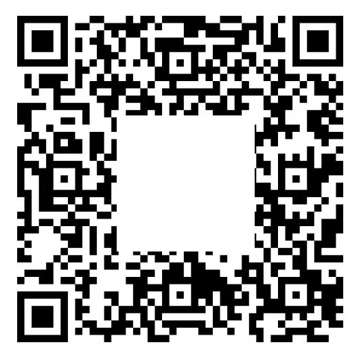

# 支持作者

如果这个项目帮你省了时间，或者你用这台板子做出了自己的东西，欢迎打赏。

## 微信收款码

下面这张码已经去掉了微信头像、昵称和 branding，只保留可扫描的二维码本体——扫码直接进入微信支付，**金额由你决定**。

> 二维码用纠错区覆盖掉原头像后重新校验过，`wxp://` payload 与原图完全一致，可正常扫码。
> 图片文件：`docs/assets/微信收款码-纯二维码.png`（54 KB，纯黑白，无个人信息）。

## 其他支持方式

| 方式 | 操作 |
|---|---|
| **Star** | 点仓库右上角 ⭐，让更多人看到 |
| **Issue** | 遇到 bug 或想加功能，提 Issue，我会回复 |
| **PR** | 修好了某个驱动、补了某块板的适配，直接发 Pull Request |
| **传播** | 把仓库分享给同样在折腾 RK3399 会议平板的人 |

## 说明

打赏完全自愿，不影响任何技术支持。Issue 和 PR 同样算支持——开源项目最缺的从来不是钱，是用的人和测试反馈。
